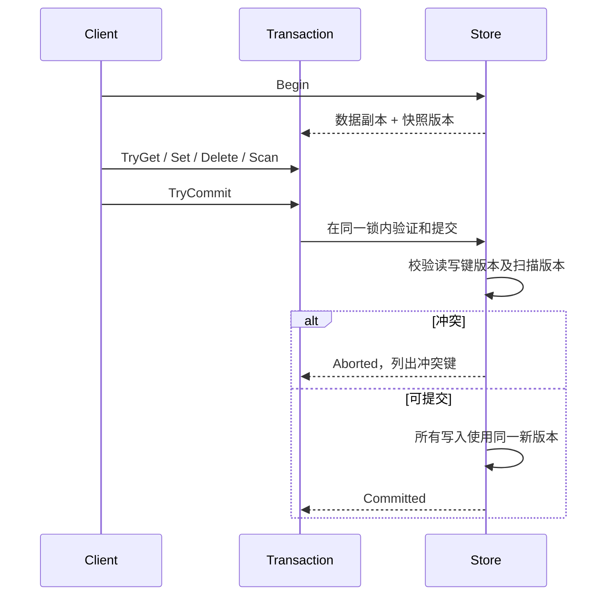

# 事务设计

## 状态与提交协议

事务将读取绑定到开始时的快照，并把本地写集覆盖在该快照上。不会锁住事务执行期间的整个存储。只在创建快照和提交时持有存储锁。

对于每个被读取或写入的键，提交要求当前版本等于快照版本。即使事务先写后读，验证也覆盖原快照版本，所以不能覆盖其他事务已经提交的值。只读事务如果读到了后来被改动的键也会冲突；这是将成功提交按提交顺序串行化的简明策略。

`Scan` 涵盖没有实际存在的键，单独的键读集无法发现未来插入的键，因此记录扫描发生并比较存储全局版本。扫描使用更保守的整个存储范围，而不是维护复杂的范围谓词索引。

## 关键不变量

1. 一个提交要么验证失败且不写入任何键，要么全部写入在锁内以一个新版本发布。
2. 缺失键版本为 0，删除后的键保留正版本；“从未存在”与“曾被修改后删除”不同。
3. 只有成功的非空写集推进全局版本。删除不存在键也属于写操作，保留其写冲突语义。
4. 所有业务值为不可变 `string`，快照不会通过共享可变对象泄漏后续修改。
5. 事务只能从 `Active` 进入 `Committed` 或 `Aborted`，不能重启；冲突重试需要完整重做业务计算。

在所声明的单调用者事务约束下，成功提交可按持锁提交顺序排列：每个事务观察到的键和谓词直到自己的提交时仍与快照一致。这也阻止经典写偏斜。读到旧快照但最终失败的事务不进入已提交历史。

## 复杂度与工程边界

`Begin` 时间和空间均为 O(N)，N 包含墓碑；点读和本地写平均 O(1)；扫描为 O(N + W + M log M)（M 是返回键数）；提交遍历 R+W 个键，冲突键排序为 O(C log C)。一个锁限制提交吞吐量，但也让验证与发布的线性化位置清楚。

测试用业务不变量和独立字典模型校验行为，而不是只断言内部集合的内容。并发测试有明确的提交完成数和余额总和预期；重试设上限，避免 CI 永久挂起。没有性能压测，因此不声称数据库级吞吐量。

若扩展到持久化，需要先设计 WAL 刷盘与恢复协议，再决定提交可见时间；当前锁内原子可见性不等同于断电持久性。
